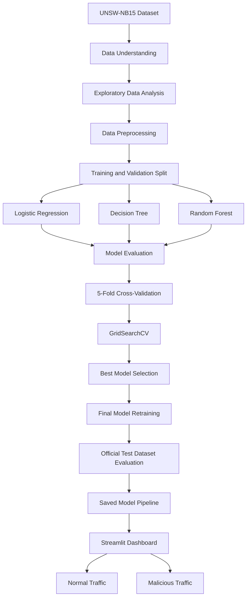

# Network Intrusion Detection System

A Machine Learning-based Network Intrusion Detection
System (NIDS) that classifies network traffic as normal
or malicious using the UNSW-NB15 dataset.

The project implements multiple classification algorithms,
hyperparameter optimization, performance evaluation and
an interactive Streamlit dashboard for network traffic
analysis and intrusion prediction.

## Project Objectives

- Detect malicious network traffic using Machine Learning.
- Perform exploratory data analysis on network traffic.
- Compare multiple classification algorithms.
- Optimize model performance using GridSearchCV.
- Validate models using 5-fold cross-validation.
- Minimize false negatives and improve attack detection.
- Predict unseen network traffic records.
- Provide an interactive and user-friendly dashboard.

##  Key Features

- Binary classification: Normal or Malicious.
- Automated data preprocessing.
- Missing value handling.
- Categorical feature encoding.
- Numerical feature scaling.
- Machine Learning model comparison.
- Group-aware 5-fold cross-validation.
- Hyperparameter tuning using GridSearchCV.
- Automatic best model selection.
- Single network record prediction.
- Batch prediction through CSV upload.
- Probability-based risk indication.
- Interactive data visualization.
- Downloadable prediction reports.

##  Dataset

The project uses the UNSW-NB15 dataset, developed
by the University of New South Wales (UNSW).

| Description | Details |
|---|---|
| Dataset | UNSW-NB15 |
| Training Records | 175,341 |
| Testing Records | 82,332 |
| Total Records | 257,673 |
| Original Columns | 45 |
| Input Features | 42 |
| Numerical Features | 39 |
| Categorical Features | 3 |
| Target Variable | label |
| Classification | Binary |

### Target Classes

- 0: Normal Network Traffic
- 1: Malicious Network Traffic

### Attack Categories

- Analysis
- Backdoor
- DoS
- Exploits
- Fuzzers
- Generic
- Reconnaissance
- Shellcode
- Worms

Dataset Source:
[UNSW-NB15 Official Dataset](https://research.unsw.edu.au/projects/unsw-nb15-dataset)

##  Technologies Used

| Technology | Purpose |
|---|---|
| Python | Programming Language |
| Pandas | Data Manipulation |
| NumPy | Numerical Computation |
| Matplotlib | Data Visualization |
| Seaborn | Statistical Visualization |
| Plotly | Interactive Visualization |
| Scikit-learn | Machine Learning |
| Joblib | Model Serialization |
| Jupyter Notebook | Model Development |
| Streamlit | Web Application |
| Pytest | Unit Testing |

##  Machine Learning Algorithms

### 1. Logistic Regression

A classification algorithm that estimates the probability
of network traffic belonging to the malicious class.

### 2. Decision Tree

A tree-based classification algorithm that makes decisions
using network traffic features and decision rules.

### 3. Random Forest

An ensemble learning algorithm that combines multiple
decision trees to improve classification performance
and reduce overfitting.

##  Project Workflow

1. Dataset Collection
2. Data Understanding
3. Exploratory Data Analysis
4. Data Preprocessing
5. Training and Validation Split
6. Machine Learning Model Training
7. Model Evaluation
8. 5-Fold Cross-Validation
9. Hyperparameter Tuning
10. Best Model Selection
11. Final Model Testing
12. Unseen Data Prediction
13. Streamlit Dashboard Development

##  System Architecture



##  Project Structure

```text
Network_Intrusion_Detection/
│
├── .streamlit/
│   └── config.toml
│
├── data/
│   ├── raw/
│   └── processed/
│
├── notebooks/
│   ├── 01_data_understanding.ipynb
│   ├── 02_exploratory_data_analysis.ipynb
│   ├── 03_data_preprocessing.ipynb
│   ├── 04_train_test_split.ipynb
│   ├── 05_model_training.ipynb
│   ├── 06_model_evaluation.ipynb
│   ├── 07_cross_validation.ipynb
│   ├── 08_hyperparameter_tuning.ipynb
│   ├── 09_best_model_selection.ipynb
│   └── 10_unseen_data_prediction.ipynb
│
├── src/
│   ├── __init__.py
│   ├── data_loader.py
│   ├── preprocessing.py
│   ├── train_models.py
│   ├── evaluate_models.py
│   ├── cross_validation.py
│   ├── hyperparameter_tuning.py
│   └── predict.py
│
├── models/
│   ├── logistic_regression.pkl
│   ├── decision_tree.pkl
│   ├── random_forest.pkl
│   ├── tuned_logistic_regression.pkl
│   ├── tuned_decision_tree.pkl
│   ├── tuned_random_forest.pkl
│   └── best_model_pipeline.pkl
│
├── reports/
│   ├── figures/
│   └── results/
│       └── predictions/
│
├── dashboard/
│   ├── app.py
│   ├── utils.py
│   └── pages/
│       ├── 1_Dataset_Overview.py
│       ├── 2_Data_Analysis.py
│       ├── 3_Model_Performance.py
│       └── 4_Intrusion_Prediction.py
│
├── tests/
│   ├── test_preprocessing.py
│   └── test_prediction.py
│
├── requirements.txt
├── .gitignore
└── README.md
```

##  Data Preprocessing

The following preprocessing techniques are applied:

- Missing value identification.
- Infinite value handling.
- Removal of unnecessary columns.
- Numerical and categorical feature separation.
- Median imputation for numerical features.
- Most frequent imputation for categorical features.
- One-Hot Encoding.
- Standard Scaling for Logistic Regression.
- Duplicate-record overlap prevention between
  training and validation partitions.

Preprocessing is integrated into the Machine Learning
pipeline to ensure consistent training and prediction
and reduce data leakage.

##  Model Evaluation

The models are evaluated using the following metrics:

| Metric | Description |
|---|---|
| Accuracy | Overall correct predictions |
| Precision | Correct malicious predictions |
| Recall | Proportion of actual attacks detected |
| F1 Score | Balance between precision and recall |
| ROC-AUC | Ability to distinguish between classes |
| False Positive | Normal traffic classified as malicious |
| False Negative | Malicious traffic classified as normal |

Special attention is given to recall and false negatives
because undetected malicious traffic can create serious
security risks.

##  Hyperparameter Tuning

GridSearchCV is used to identify suitable hyperparameters
for all three classification algorithms.

The project uses:

- Group-aware 5-fold cross-validation.
- F1-score as the primary optimization metric.
- Baseline and tuned model comparison.
- Validation-based best model selection.
- Independent official test dataset evaluation.

##  Final Model Performance

The best-performing model is automatically selected
based on validation performance.

Final evaluation results are available in:

- reports/results/final_model_performance.csv
- reports/results/final_model_metadata.json
- reports/results/final_classification_report.csv
- reports/results/final_model_ranking.csv

The final trained model is saved as:

`models/best_model_pipeline.pkl`

This file contains both the fitted preprocessing pipeline
and the trained classification model.

##  Streamlit Dashboard

The application contains five pages.

### 1. Home

- Project overview.
- Final model performance.
- Selected model information.
- Key performance indicators.

### 2. Dataset Overview

- Dataset information.
- Training and testing records.
- Feature descriptions.
- Statistical summary.
- Class distribution.

### 3. Data Analysis

- Attack category distribution.
- Protocol analysis.
- Numerical feature distribution.
- Correlation analysis.

### 4. Model Performance

- Baseline model comparison.
- Cross-validation results.
- Hyperparameter tuning results.
- Confusion matrix.
- ROC curve.
- Final model evaluation.

### 5. Intrusion Prediction

- Manual network feature input.
- Normal and malicious sample records.
- CSV file upload.
- Single and batch prediction.
- Malicious traffic probability.
- Risk indication.
- Downloadable prediction reports.

##  Installation and Setup

### Step 1: Open the Project Directory

```powershell
cd Network_Intrusion_Detection
```

### Step 2: Create a Virtual Environment

```powershell
python -m venv .venv
```

### Step 3: Activate the Virtual Environment

Windows PowerShell:

```powershell
.\.venv\Scripts\Activate.ps1
```

### Step 4: Install Dependencies

```powershell
python -m pip install -r requirements.txt
```

### Step 5: Download the Dataset

Download the UNSW-NB15 training and testing datasets
from the official dataset website.

Place the following files inside the data/raw directory:

```text
data/raw/
├── UNSW_NB15_training-set.csv
└── UNSW_NB15_testing-set.csv
```

### Step 6: Execute the Jupyter Notebooks

Start Jupyter Notebook:

```powershell
python -m notebook
```

Execute all notebooks sequentially from:

01_data_understanding.ipynb

to:

10_unseen_data_prediction.ipynb

This generates the trained models, processed datasets,
evaluation reports and visualization files.

If all generated files are already available,
this step can be skipped.

### Step 7: Run the Streamlit Application

```powershell
python -m streamlit run dashboard/app.py
```

Open the following URL in your browser:

http://localhost:8501

## 🔮 Prediction Process

1. Enter network traffic features or upload a CSV file.
2. Validate the input data.
3. Apply automatic preprocessing.
4. Pass the processed data to the trained model.
5. Generate the classification result.
6. Display malicious and normal probabilities.
7. Generate a downloadable prediction report.

## 🚦 Risk Indication

| Malicious Probability | Risk Level |
|---|---|
| 0% to below 20% | Very Low |
| 20% to below 40% | Low |
| 40% to below 60% | Moderate |
| 60% to below 80% | High |
| 80% to 100% | Critical |

These categories are probability-based indicators
for visualization and do not represent scientifically
validated attack severity.

##  Project Limitations

- The system depends on the quality of the training data.
- The model may not detect every unknown attack.
- False positives and false negatives are possible.
- The system requires extracted network traffic features.
- Live network packet capture is not implemented.
- Automatic attack blocking is not implemented.
- Model probabilities may not be calibrated.
- Dataset overlap may affect benchmark performance.

##  Future Scope

- Real-time network traffic monitoring.
- Live packet capture using Scapy or PyShark.
- Automated network feature extraction.
- Multiclass attack classification.
- Deep Learning-based intrusion detection.
- Zero-day attack detection research.
- Email and SMS security alerts.
- Automated firewall integration.
- Cloud deployment.
- Continuous model retraining.
- Explainable AI using SHAP and LIME.

## Academic Information

- Project: Network Intrusion Detection System
- Course: Master of Computer Applications (MCA)
- Section: D
- Domain: Machine Learning
- University: Brainware University

##  Author

Anubhab Ghosh

Master of Computer Applications (MCA)

Brainware University

##  References

- UNSW-NB15 Dataset
  https://research.unsw.edu.au/projects/unsw-nb15-dataset

- Scikit-learn Documentation
  https://scikit-learn.org/

- Streamlit Documentation
  https://docs.streamlit.io/

- Pandas Documentation
  https://pandas.pydata.org/docs/

- Plotly Documentation
  https://plotly.com/python/

---

Developed for academic and research purposes.